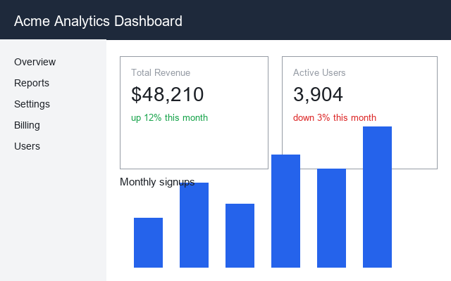
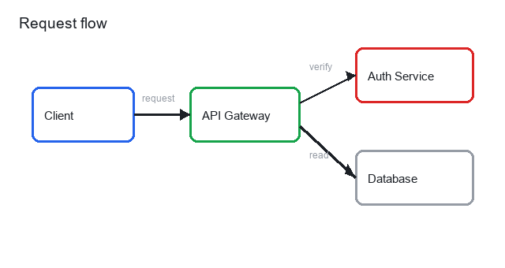

# Northwind CLI

The Northwind CLI deploys your app and shows you what changed.


## Install

```
npm install -g northwind
```

## Dashboard



The dashboard shows how your deployment is doing.


## Revenue


Revenue by quarter, comparing 2024 against 2023.

![Revenue by quarter][chart]

[chart]: docs/revenue-chart.png

## Architecture



The client talks to the API gateway, which forwards to the auth service.

```bash
northwind deploy --env production
```

Build status: 
