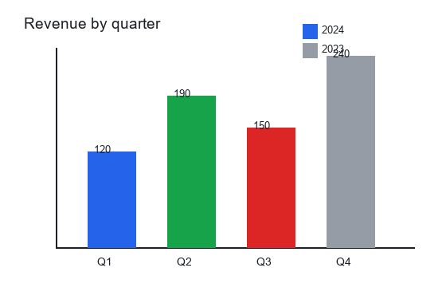

# Charting library

A tiny library for rendering charts in the browser.

## Quarterly revenue

Revenue rose through the year, ending at 240 in Q4.

## User growth

The trend is consistently upward across the week.

## Terminal

The build output is shown below.

